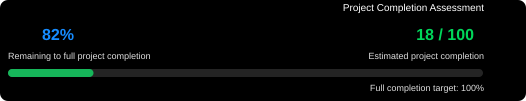

# LEONIX — Project Completion

## Current assessment

**Estimated completion: 18 / 100**

This is an independent assessment of the current LEONIX repository as a technical research and testing project. It is **not** a measurement of GTA VI development progress, and it does not mean the game itself is 18% complete.

## Score breakdown

| Area | Score | Assessment |
| --- | ---: | --- |
| Project structure and documentation | 8 / 20 | The main research folders and documentation templates exist. |
| Test plans and methodology | 4 / 20 | Test cases and recording rules exist, but most planned tests have not been completed. |
| Recorded test observations | 3 / 15 | One user-reported gameplay session and several graphics observations are documented. |
| Verified measurements and evidence | 1 / 20 | The reported 8 FPS has not been independently verified; raw capture evidence and full test conditions are missing. |
| Reproduction and issue resolution | 1 / 15 | A black-shadow issue is recorded, but reproduction steps and a confirmed fix are not available. |
| Release readiness and repository consistency | 1 / 10 | The research area is not release-ready; some top-level documentation still describes an older executable-project structure. |

**Total: 18 / 100**

## What is already done

- Research folder structure has been created.
- Documentation templates exist for benchmarks, monitoring, performance, configuration, and issue tracking.
- A preliminary user-reported gameplay observation has been recorded.
- The reported test reached gameplay and recorded **8 FPS**.
- Graphics observations include black shadows and motion/animation rendering problems.
- A project completion tracker has been added.

## Main work remaining

1. Resolve inconsistencies between the top-level README / changelog and the current research-only project structure.
2. Record complete test conditions, including exact GPU model and VRAM, driver version, game build, graphics settings, scene, and capture duration.
3. Preserve authorized screenshots or logs and link them as evidence.
4. Repeat measurements with a documented method; verify FPS, frame times, and system telemetry.
5. Add reproducible steps for graphics and gameplay issues.
6. Track fixes and retest them before marking issues resolved.
7. Review documentation and release readiness when the research records are complete.

## Scoring rules

- This score is a reasoned estimate based on the files currently present in the repository.
- Missing or unverified information does not count as completed work.
- User-reported observations are recorded as reports, not as independently verified results.
- The score should increase only when concrete work, test records, evidence, or verified fixes are added.

**Last assessed:** 2026-11-27

*LEONIX — Built with ambition. Driven by innovation.*
